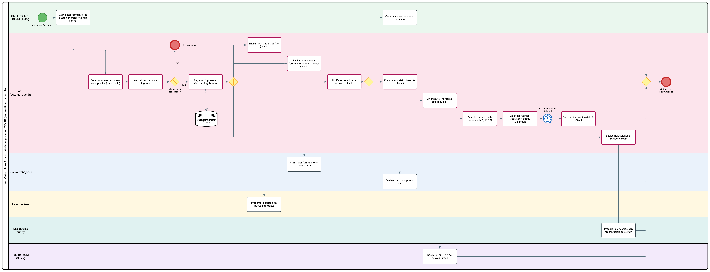
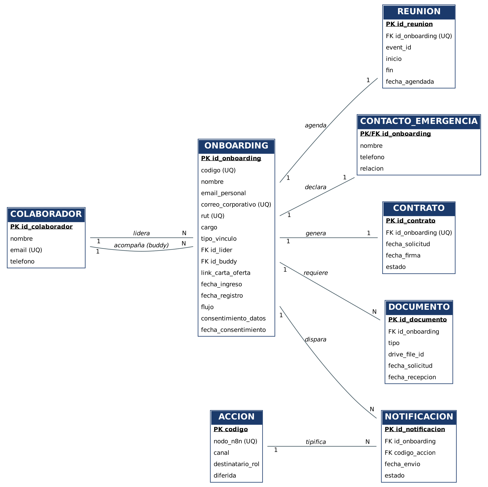

# Onboarding en You Order Me — Sistema de información para la incorporación de nuevos trabajadores

**ICN292 · Sistemas de Información para la Gestión · Paralelo P101 · Entrega 2**
Universidad Técnica Federico Santa María — Departamento de Industrias

> **Versión defendida:** tag [`v1.0-e2`](https://github.com/Danielalopezg/ICN292-Proyecto-pyme-YOM/tree/v1.0-e2) · **Motor SQL:** SQLite 3 (probado con 3.45; sirve cualquier versión ≥ 3.31)

---

## El caso en un párrafo

*You Order Me* (YOM) es una PYME de software de Las Condes, ~35 personas, que vende una plataforma de gestión
comercial a empresas de consumo masivo y retail. Cada vez que entra alguien nuevo, RRHH repite a mano la misma
secuencia: juntar los datos, crear los accesos, avisar al equipo, agendar la bienvenida y pedir el contrato.
El problema no es que falten pasos, sino que **nadie sabe en qué estado va cada incorporación**: los avisos
salen uno por uno, los datos viven en una planilla que nadie reconoce como repositorio oficial y los
practicantes reciben menos pasos que los contratados.

Este repositorio contiene la solución completa: el proceso rediseñado en **BPMN**, su automatización en
**n8n** —probada con la empresa— y los datos del proceso modelados en una base **SQLite normalizada a 3FN**,
con consultas de negocio que comparan el flujo manual (AS-IS) contra el automatizado (TO-BE).

## Lo que cambió, medido con SQL

Las ocho consultas de `db/queries.sql` corren sobre 20 incorporaciones de prueba. **Ningún número de este
repositorio ni del informe está escrito a mano**: todos salen de esas consultas.

| Indicador | Proceso manual | Con n8n |
|---|---:|---:|
| Minutos entre el registro y cada aviso | 2.197 min (≈ 1,5 días) | **1,1 min** |
| Cobertura de la bienvenida en contratados | 52,5 % | **96,9 %** |
| Cobertura de la bienvenida en practicantes | 27,5 % | **100 %** |
| Reuniones con el *buddy* agendadas | 50 % | **100 %** |
| Días hasta el contrato firmado | 13,6 días | **8,6 días** |

La interpretación de cada consulta está en [`docs/04-sql-consultas.md`](docs/04-sql-consultas.md); la salida
literal, sin editar, en [`docs/evidencia-ejecucion.md`](docs/evidencia-ejecucion.md).

---

## Prueba de oro: clonar, cargar la base y ejecutar las consultas

### Requisito único: el cliente `sqlite3`

| Sistema | Cómo obtenerlo |
|---|---|
| macOS | ya viene instalado (`sqlite3 --version`) |
| Linux | `sudo apt install sqlite3` |
| Windows | descargar *sqlite-tools-win-x64* desde <https://www.sqlite.org/download.html>, descomprimir y usar `sqlite3.exe` (o ver alternativas abajo) |

### Pasos

```bash
# 1. Clonar
git clone https://github.com/Danielalopezg/ICN292-Proyecto-pyme-YOM.git
cd ICN292-Proyecto-pyme-YOM

# 2. Crear la base y cargar los datos (si db/yom.db ya existe, schema.sql la reinicia)
sqlite3 db/yom.db < db/schema.sql
sqlite3 db/yom.db < db/seed.sql

# 3. Ejecutar las 8 consultas de negocio
sqlite3 -header -column db/yom.db < db/queries.sql
```

Resultado esperado del paso 3 (primeras líneas):

```
flujo   avisos  minutos_promedio  minutos_maximo
------  ------  ----------------  --------------
manual  25      2197.4            4217.5
n8n     69      1.1               1.7
```

**Opcional — comprobar las restricciones del modelo:** `sqlite3 db/yom.db < db/pruebas_restricciones.sql`
debe mostrar exactamente 8 errores. Cada uno es un dato inválido que la base rechaza por diseño.

### Alternativas sin terminal (Windows)

- **DB Browser for SQLite** (<https://sqlitebrowser.org>): *Nueva base de datos* → `db/yom.db`; pestaña
  *Ejecutar SQL* → abrir y ejecutar `schema.sql`, luego `seed.sql` (guardar cambios), luego `queries.sql`.
- **VS Code + SQLTools** con el driver SQLite: conectar a `db/yom.db` y ejecutar los tres archivos en orden.
- **Python** (sin instalar `sqlite3`): `pip install pandas==2.2.3` y `python scripts/correr_consultas.py`.

---

## El proceso rediseñado (TO-BE)

Ahora la incorporación la dispara un formulario. n8n detecta la respuesta nueva (*polling* cada minuto),
registra el ingreso y lanza **ocho acciones en paralelo** entre correos, Slack y Google Calendar.



El AS-IS, los cambios respecto de la Entrega 1 y la trazabilidad de cada tarea con su nodo de n8n están en
[`docs/02-bpmn.md`](docs/02-bpmn.md) y [`docs/05-automatizacion-n8n.md`](docs/05-automatizacion-n8n.md).

## El modelo de datos (3FN)

Las 26 columnas sueltas de la planilla `Onboarding_Master` pasaron a **ocho tablas y tres vistas** en tercera
forma normal. Líder y *buddy* dejaron de repetirse en cada fila: ahora son dos roles de una tabla. Ocho
restricciones —PK, FK, CHECK y UNIQUE— rechazan datos inválidos, y cada una está probada en
`db/pruebas_restricciones.sql`.



La justificación de cada decisión de normalización y el diccionario de datos están en
[`docs/03-modelo-datos.md`](docs/03-modelo-datos.md).

### Cómo se conectan proceso, automatización y datos

1. RRHH completa el *Formulario de Recolección de Datos Generales* (Google Forms).
2. n8n detecta la nueva respuesta, registra el ingreso en la planilla `Onboarding_Master` y dispara en
   paralelo las ocho acciones de bienvenida.
3. La base SQL es la versión **normalizada** de esa planilla: cada fila es un `onboarding`, cada nodo de
   acción de n8n es una fila del catálogo `accion`, y cada ejecución es una `notificacion` con su hora.

---

## Mapa del repositorio

| Carpeta / archivo | Qué contiene | Dónde se usa en el informe |
|---|---|---|
| [`db/schema.sql`](db/schema.sql) | 8 tablas + 3 vistas en 3FN, con PK, FK, CHECK y UNIQUE | Secciones 5 y 6 |
| [`db/seed.sql`](db/seed.sql) | 20 incorporaciones **sintéticas** (10 manuales, 10 con n8n) | Sección 6 |
| [`db/queries.sql`](db/queries.sql) | Las 8 consultas de negocio | Sección 6 |
| [`db/pruebas_restricciones.sql`](db/pruebas_restricciones.sql) | 8 inserciones inválidas que la base rechaza | Sección 5 |
| [`automatizacion/`](automatizacion/) | Flujo n8n exportado (sin identificadores internos) y captura del canvas | Sección 4 |
| [`docs/`](docs/) | `00-caso-pyme` … `05-automatizacion-n8n`, `CHANGELOG`, `DECLARACION_IA`, evidencia y anexos | todas |
| [`assets/`](assets/) | Diagramas ER y BPMN exportados | Secciones 4 y 5 |
| [`scripts/`](scripts/) | Generador del *seed* y del diagrama ER, sanitizador del flujo, ejecutor de consultas | reproducibilidad |
| [`informe/`](informe/) | Informe de la Entrega 2 en PDF y Word, más el acta de la entrevista | — |
| [`presentacion/`](presentacion/) | Diapositivas de la defensa en PPTX y PDF | — |
| [`app/`](app/) | Visor opcional en Streamlit (no requerido por la pauta) | — |

### Dónde está cada cosa que pide la pauta

| Pide la pauta | Dónde está |
|---|---|
| BPMN to-be final + cambios vs. Entrega 1 | [`docs/02-bpmn.md`](docs/02-bpmn.md) · [`docs/CHANGELOG.md`](docs/CHANGELOG.md) |
| Flujo n8n documentado paso a paso | [`docs/05-automatizacion-n8n.md`](docs/05-automatizacion-n8n.md) · [`automatizacion/`](automatizacion/) |
| ER en 3FN justificado (anomalías evitadas) | [`docs/03-modelo-datos.md`](docs/03-modelo-datos.md) |
| `schema.sql` + `seed.sql` + ≥ 3 consultas interpretadas | [`db/`](db/) · [`docs/04-sql-consultas.md`](docs/04-sql-consultas.md) |
| Prueba de que el SQL corre | [`docs/evidencia-ejecucion.md`](docs/evidencia-ejecucion.md) |
| Informe en PDF y en Word | [`informe/`](informe/) |
| Presentación de la defensa | [`presentacion/`](presentacion/) |
| Declaración de uso de IA | [`docs/DECLARACION_IA.md`](docs/DECLARACION_IA.md) |

---

## Equipo

| Integrante | Rol en el proyecto |
|---|---|
| Juan Pablo Díaz | Diagramas BPMN (AS-IS y TO-BE) |
| Vicente Jaña | Modelo de datos y SQL |
| Daniela López | Requerimientos y repositorio |
| Alex Rebolledo | Entrevista, caso PYME y automatización n8n |
| Felipe Schorr | Informe y presentación |

## Limitaciones declaradas

- La firma del contrato baja de 13,6 a 8,6 días solo porque se puede pedir antes; el plazo depende de Buk y
  de un tercero, no del flujo.
- Los datos de `seed.sql` son **sintéticos**: ninguna persona es real y el dominio de correo es ficticio. Se
  generan con `python scripts/generar_seed.py` (semilla fija) y están calibrados con la entrevista a la Chief
  of Staff de YOM del 27-08-2026 para el flujo manual, y con el comportamiento del flujo n8n real para el
  automatizado. No son una medición de un piloto en producción.
- La base todavía no se alimenta sola desde n8n: el flujo escribe en la planilla, y la base es su versión
  normalizada.
- El historial de ejecuciones de n8n no se publica porque contiene datos de personas reales de la empresa.

Durante el trabajo detectamos cuatro hallazgos del flujo que le reportamos a YOM, cada uno con su corrección
propuesta, en [`docs/05-automatizacion-n8n.md`](docs/05-automatizacion-n8n.md).

El uso de IA está declarado en [`docs/DECLARACION_IA.md`](docs/DECLARACION_IA.md).
