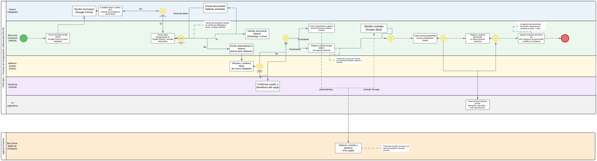
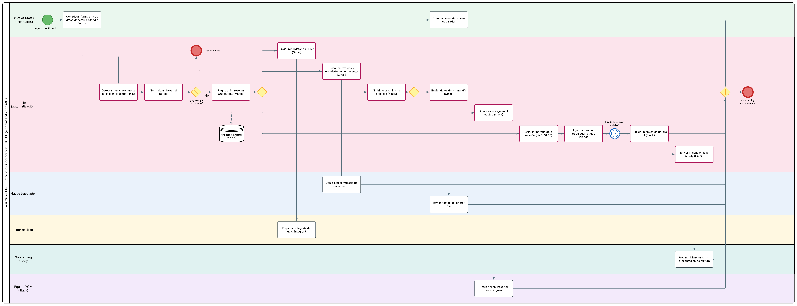

# 02 · BPMN

| Diagrama | Original en Lucidchart | Imagen exportada |
|---|---|---|
| AS-IS (E1) | https://lucid.app/lucidchart/479ac530-3d5c-40a1-a643-a0ce750119ff/edit | `assets/bpmn_asis.png` |
| TO-BE final (E2) | https://lucid.app/lucidchart/83e59d99-7da9-44f5-8383-f4097e2a85a8/edit | `assets/bpmn_tobe.png` |

Ambos exportados desde Lucidchart en PNG a 300 PPI, recortados al contenido.

## AS-IS · cómo se incorpora hoy

Proceso secuencial: cada actividad espera a que termine la anterior, y esa transición ocurre por
correo o mensaje que alguien debe acordarse de enviar. Lanes: Nuevo trabajador | Recursos Humanos |
Jefatura / Equipo directo | Gerencia general | TI / Ingeniería | Agencia externa y Buk.

## TO-BE final · proceso automatizado con n8n

El disparador es el formulario de datos generales que completa RRHH. n8n registra el ingreso en
`Onboarding_Master` y abre un gateway paralelo con **6 ramas y 8 acciones**. Lanes: Nuevo Trabajador |
n8n (Automatización) | Chief of Staff / RRHH | Líder de Área | Onboarding Buddy | Equipo YOM (Slack).

## Cambios del TO-BE respecto a la Entrega 1

| Entrega 1 | Entrega 2 (final) | Por qué |
|---|---|---|
| El disparador era el formulario del nuevo trabajador | El disparador es el **formulario de datos generales que completa RRHH** | Los datos que necesita la automatización (líder, buddy, correo corporativo, carta de oferta) los conoce RRHH, no el trabajador; así nada depende de que el trabajador responda primero |
| No había registro explícito | Tarea **Registrar ingreso en Onboarding_Master** antes del gateway | Trazabilidad: es la fila que luego se normaliza en la base SQL |
| 7 acciones en paralelo | **6 ramas, 8 acciones** (dos ramas son secuenciales) | Así quedó implementado y probado en n8n |
| Bienvenida en Slack al confirmar | Anuncio previo al equipo + **mensaje el día 1 tras un evento temporizador** | El nodo `Wait` espera el fin de la reunión del primer día |
| Sin control de duplicados | Gateway **¿Fila ya procesada?** | Corresponde al nodo `If` (ver hallazgo en `05`) |
| Tareas en tercera persona ("Recibe…") | Tareas en infinitivo ("Enviar…", "Agendar…") | Convención BPMN verbo + objeto |

La correspondencia tarea BPMN ↔ nodo n8n ↔ tabla está en [`05-automatizacion-n8n.md`](05-automatizacion-n8n.md).
