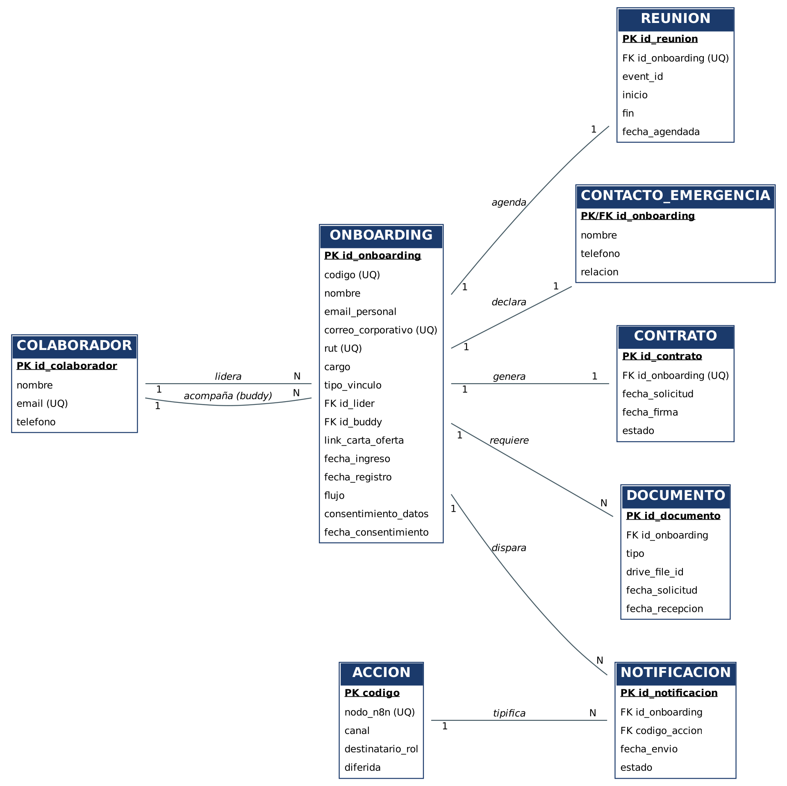

# 03 · Modelo de datos (3FN) y diccionario

Script: [`db/schema.sql`](../db/schema.sql) · Pruebas: [`db/pruebas_restricciones.sql`](../db/pruebas_restricciones.sql)

## Punto de partida: la planilla `Onboarding_Master`

El flujo n8n registra cada ingreso como una fila en `Onboarding_Master` (nodo *Append row in sheet*), con estas
26 columnas: `onboardingId, nombre, email, fechaIngreso, buddyNombre, buddyEmail, estado, createdAt, lider,
liderEmail, cartaLink, contrasenha, reunionAgendada, folderId, folderUrl, afpAfiliacionFileIds,
afpUltimasCotizacionesFileIds, saludAfiliacionFileIds, cedulaFileIds, antecedentesFileIds, fotoPersonalFileIds,
meetingEventId, cargo, correoEnviadoAt, nuevocorreo, telefonobuddy`. Sirve para operar, pero no está
normalizada. El modelo SQL es su versión en 3FN.

## Anomalías evitadas

| Problema en `Onboarding_Master` | Tipo | Ejemplo en YOM | Solución en el modelo |
|---|---|---|---|
| Líder y buddy (nombre, correo, teléfono) se repiten en cada fila | Actualización | Si un buddy cambia de teléfono hay que corregir todas sus filas; si se olvida una, el correo *Datos importantes* le envía al trabajador un contacto viejo | Tabla `colaborador`, referenciada por `id_lider` e `id_buddy` |
| No se puede registrar a una persona sin un ingreso | Inserción | No hay dónde anotar que alguien está disponible como buddy hasta que exista un ingreso | `colaborador` existe por sí sola |
| Borrar un ingreso borra el único registro de un buddy | Eliminación | Si se elimina el único ingreso en que una persona fue buddy, se pierde su contacto | `colaborador` es independiente de `onboarding` |
| Una columna por documento (`afp…FileIds`, `saludAfiliacionFileIds`, …) | Grupo repetitivo (1FN) | Agregar un documento nuevo obliga a agregar una columna; los vacíos no distinguen "pendiente" de "no aplica" | Tabla `documento`, una fila por documento y `UNIQUE (id_onboarding, tipo)` |
| `estado` se escribe como texto fijo ("Datos solicitados") | Dato no actualizado | La fila sigue diciendo "Datos solicitados" aunque el contrato ya esté firmado | Estado **derivado** en `v_estado_onboarding` |
| `createdAt` se llena con la fecha de entrada (nodo *Edit Fields*) | Dato inconsistente | No se puede medir cuánto demora el proceso porque no queda la fecha real de registro | Atributos separados `fecha_registro` y `fecha_ingreso` |
| Canal y destinatario de cada aviso dependen del tipo de aviso, no del envío | Dependencia transitiva (3FN) | Guardar "slack" y "equipo" en cada notificación del anuncio | Catálogo `accion` (una fila por nodo n8n) |
| Los asistentes de la reunión repetirían al buddy | Dependencia transitiva (3FN) | El buddy ya está en el onboarding | `reunion` no guarda asistentes |
| `contrasenha` en texto plano | Seguridad / Ley 21.719 | Cualquiera con acceso a la planilla ve las contraseñas | **No se almacena** |

**Formas normales:** 1FN (atributos atómicos, sin grupos repetitivos), 2FN (todas las PK son simples, no hay
dependencias parciales) y 3FN (canal/destinatario, gestionado_por_buk, estado y asistentes ya no dependen
transitivamente de la clave; se derivan en vistas o en el catálogo).

## Diccionario de datos

| Tabla | Atributo | Tipo | Clave / regla | Origen en n8n |
|---|---|---|---|---|
| colaborador | id_colaborador | INTEGER | PK | — |
| colaborador | nombre, email, telefono | TEXT | email NOT NULL UNIQUE | Líder / Email Líder / Onboarding Buddy / Email y Teléfono Onboarding Buddy |
| onboarding | id_onboarding | INTEGER | PK | — |
| onboarding | codigo | TEXT | NOT NULL UNIQUE | `onboardingId` (email + fecha) |
| onboarding | nombre, email_personal, cargo | TEXT | NOT NULL | Nombre / Email / Cargo nuevo integrante |
| onboarding | correo_corporativo | TEXT | UNIQUE | Correo nuevo yom |
| onboarding | rut | TEXT | UNIQUE, NULL hasta el formulario de documentos | formulario del trabajador |
| onboarding | tipo_vinculo | TEXT | CHECK ∈ {contratado, practicante} | **propuesto** para el formulario |
| onboarding | id_lider, id_buddy | INTEGER | FK → colaborador; CHECK id_lider ≠ id_buddy | Líder / Onboarding Buddy |
| onboarding | link_carta_oferta | TEXT | — | Link Carta de Oferta |
| onboarding | fecha_ingreso | TEXT (fecha) | NOT NULL | Fecha de entrada |
| onboarding | fecha_registro | TEXT (fecha-hora) | NOT NULL | momento en que RRHH envía el formulario |
| onboarding | flujo | TEXT | CHECK ∈ {manual, n8n} | — (separa AS-IS de TO-BE) |
| onboarding | consentimiento_datos, fecha_consentimiento | INTEGER, TEXT | CHECK ∈ {0,1} | **propuesto** para el formulario del trabajador |
| contacto_emergencia | id_onboarding | INTEGER | PK y FK (1:1), ON DELETE CASCADE | formulario del trabajador |
| contacto_emergencia | nombre, telefono, relacion | TEXT | NOT NULL | formulario del trabajador |
| contrato | id_contrato | INTEGER | PK | — |
| contrato | id_onboarding | INTEGER | FK, UNIQUE (1:1) | — |
| contrato | fecha_solicitud, fecha_firma | TEXT | CHECK firmado ⇔ fecha_firma no nula | Buk / contrato interno |
| contrato | estado | TEXT | CHECK ∈ {solicitado, enviado_firma, firmado} | — |
| documento | id_documento | INTEGER | PK | — |
| documento | id_onboarding | INTEGER | FK; UNIQUE (id_onboarding, tipo) | — |
| documento | tipo | TEXT | CHECK (6 tipos) | columnas `…FileIds` de la planilla |
| documento | drive_file_id | TEXT | solo la referencia, nunca el contenido | `…FileIds` |
| documento | fecha_solicitud, fecha_recepcion | TEXT | recepcion NULL = pendiente | — |
| accion | codigo | TEXT | PK | — |
| accion | nodo_n8n | TEXT | NOT NULL UNIQUE | nombre exacto del nodo |
| accion | canal | TEXT | CHECK ∈ {correo, slack, calendario} | tipo de nodo (Gmail, Slack, Google Calendar) |
| accion | destinatario_rol | TEXT | CHECK (6 roles) | destinatario del nodo |
| accion | diferida | INTEGER | 1 = sale después del nodo `Wait` | — |
| notificacion | id_notificacion | INTEGER | PK | — |
| notificacion | id_onboarding, codigo_accion | — | FK; UNIQUE (id_onboarding, codigo_accion) | una ejecución de un nodo |
| notificacion | fecha_envio | TEXT | NOT NULL | — |
| notificacion | estado | TEXT | CHECK ∈ {enviado, fallido} | resultado de la ejecución |
| reunion | id_reunion | INTEGER | PK | — |
| reunion | id_onboarding | INTEGER | FK, UNIQUE | — |
| reunion | event_id | TEXT | — | `meetingEventId` |
| reunion | inicio, fin | TEXT | CHECK fin > inicio | `Code in JavaScript1` (10:00–11:00 del día de ingreso) |
| reunion | fecha_agendada | TEXT | NOT NULL | — |

**Vistas:** `v_notificacion` (agrega canal y destinatario desde `accion`), `v_contrato` (`gestionado_por_buk`
y `dias_hasta_firma` derivados) y `v_estado_onboarding` (estado derivado de cada ingreso).
